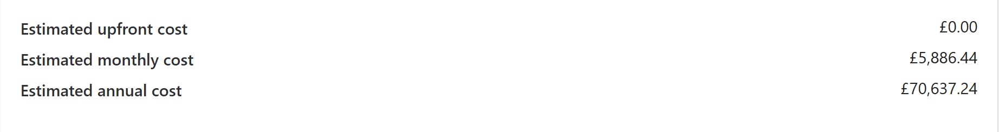

# ☁️ Azure: cloud and data fundamentals (DP-900)

Research, a costed estimate and a client recommendation on cloud computing, plus Microsoft's DP-900 guided labs on relational, non-relational and analytical data in Azure and Microsoft Fabric. It also covers the UK law on computer use and data.

## 🔎 At a glance

| | |
|---|---|
| **Tools** | Azure Pricing Calculator. In the guided labs: Azure SQL Database, Azure Storage (Blob storage, Data Lake Storage Gen2 and Azure Files), Azure Cosmos DB, Microsoft Fabric (lakehouse, SQL analytics endpoint, eventstream and eventhouse) and Power BI |
| **Data** | The pricing calculator's enterprise BI template, and the labs' sample data: products, product files and New York taxi trips |
| **Bootcamp week** | Week 5 (October 2026), Level 3 Data Technician Skills Bootcamp, Leep Talent |
| **Type** | Individual research and scenario work, plus guided labs from Microsoft's DP-900 course, "Introduction to Microsoft Azure Data" |

## 🎯 Objective

- Explain what cloud computing is, how its service and deployment models differ, and when each suits an organisation.
- Estimate what a cloud business intelligence (BI) solution would cost.
- Act as a cloud consultant for DataCore Enterprises, a large company with its own IT staff. It wants to move its internal database servers to the cloud and keep full control of operating systems and storage.
- Work hands-on with Azure's relational, non-relational and analytical data services in guided labs.

## 🗂️ Data

The cost estimate uses the Azure Pricing Calculator's "Design an enterprise BI solution" template. It prices a pipeline that moves data from an on-premises data warehouse to the cloud and serves it through a BI model. The labs use Microsoft's sample data: an AdventureWorks product database, product files in JSON, sample product items, and New York taxi trips.

## ☁️ Cloud computing basics

Cloud computing means renting servers, storage, databases and software over the internet instead of buying and running the hardware yourself. For a business, the main benefits are:

- **Lower upfront cost:** spending moves from buying hardware to paying as you go.
- **Scaling:** capacity can grow for busy periods and shrink afterwards.
- **Speed:** systems can be set up quickly, with less maintenance.
- **Reliability:** data is copied across several data centres.
- **Tools on demand:** machine learning and AI are available without building them yourself.

The alternative is running everything on premises, which gives full control but needs a large upfront investment and in-house IT staff.

### Service models

| Model | Provider manages | Customer manages | Example |
|---|---|---|---|
| IaaS | Physical hardware, networking, virtualisation | Operating system, software, applications, data | Azure Virtual Machines |
| PaaS | All of the above, plus the operating system, runtime and development tools | Their own applications and data | Azure SQL Database, Azure App Service |
| SaaS | Everything, including updates and security | Only their own use of it | Microsoft 365, Salesforce |

I also compared the three main providers. AWS has the widest range of services. Azure integrates closely with Microsoft 365, Teams and Power BI and suits hybrid set-ups. Google Cloud is the smallest of the three but growing fastest, and is best known for BigQuery and Vertex AI.

### Deployment models

| Model | Suits | Example |
|---|---|---|
| Public | Organisations that want low upfront cost and need to scale quickly | An online shop renting extra capacity for Black Friday. Netflix runs its back-end systems on AWS, while its video is delivered through its own network. |
| Private | Sensitive data, strict regulation and steady demand. The infrastructure is dedicated to one organisation, in-house or hosted by a provider. | A bank storing customer accounts and transactions |
| Hybrid | A mix of sensitive and everyday work, or a gradual move to the cloud | A bank keeping accounts private while running its mobile app in the public cloud |
| Community | Organisations in one sector with shared rules | NHS trusts sharing a platform for patient records |

## 💷 Cost estimate: enterprise BI solution



| | GBP | USD |
|---|---:|---:|
| Upfront cost | £0.00 | |
| Estimated monthly cost | £5,886.44 | $7,799.23 |
| Estimated annual cost | £70,637.24 | $93,590.81 |

The estimate shows the shift that cloud brings: no upfront hardware cost, but a running cost of about £70,600 a year that has to be budgeted and monitored.

## 🏭 DataCore Enterprises: recommendation

**IaaS.** DataCore wants full control of operating systems and storage, and already has IT staff with the skills to manage them. Under IaaS the provider runs the physical hardware, networking and virtualisation, and DataCore manages everything above that.

- **Estimating cost:** use the Azure Pricing Calculator, compare pricing options, and set the estimate against the total cost of ownership of the current on-premises servers.
- **Benefits:** no hardware to buy (spending moves from capital to operating expenditure), scaling up or down with demand, backup and replication across regions, less hardware maintenance, built-in security tools and secure remote access.
- **Risks:** pay-as-you-go costs that grow unless usage is monitored; under the shared responsibility model, DataCore still secures its own operating systems, data and access; data storage must meet UK GDPR, including where data is physically held; and an internet outage can make databases unavailable.

## 🔧 Azure services researched

| Service | What it does |
|---|---|
| Azure Data Factory | Moves data between systems and transforms it on the way, using pipelines (groups of activities that together do one job). It has more than 90 built-in connectors, and you pay for what you use. |
| Microsoft Entra ID | Cloud identity and access management, renamed from Azure Active Directory in 2023. It provides single sign-on, multi-factor authentication and conditional access. |
| Application Insights | Part of Azure Monitor. It tracks live web applications (request rates, response times, failures and calls to databases), with dashboards, alerts and queries written in KQL. |

I also suggested Azure Machine Learning for a café chain: forecasting busy days from past sales to plan staffing and stock and cut food waste.

## 🧪 Guided labs (DP-900)

| Lab | Type of data | What the lab covers |
|---|---|---|
| Explore Azure SQL Database | Relational | Creating an Azure SQL Database with the AdventureWorks sample, then querying its product tables in the Query editor |
| Explore Azure Storage for non-relational data (part 1) | Non-relational files | Creating a storage account, a blob container for JSON product files, Data Lake Storage Gen2 folders and an Azure Files share |
| Explore Azure Storage for non-relational data (part 2) | Non-relational documents | Creating an Azure Cosmos DB account with a sample database, adding an item as JSON and querying the items |
| Explore data analytics in Microsoft Fabric | Analytical | Creating a Fabric workspace and lakehouse, loading New York taxi trip data into a table and querying it through the SQL analytics endpoint |
| Explore real-time analytics in Microsoft Fabric | Streaming | Using an eventstream to ingest a live sample taxi data stream into an eventhouse, then querying it with KQL |
| Explore fundamentals of data visualisation | Reporting | Building a simple report from sample data in Power BI |

The labs follow Microsoft's published DP-900 exercises, which end with queries like these:

```sql
-- Azure SQL Database: each product with its category (a join)
SELECT p.ProductID, p.Name AS ProductName, c.Name AS Category, p.ListPrice
FROM SalesLT.Product AS p
INNER JOIN SalesLT.ProductCategory AS c
    ON p.ProductCategoryID = c.ProductCategoryID;

-- Azure Cosmos DB: items whose name contains "Helmet" (a filter)
SELECT *
FROM c
WHERE CONTAINS(c.name, "Helmet")

-- Fabric lakehouse: average trip distance by day of the week (a grouping)
SELECT DATENAME(dw, lpepPickupDatetime) AS Day,
       AVG(tripDistance) AS AvgDistance
FROM taxi_rides
GROUP BY DATENAME(dw, lpepPickupDatetime)
```

```kql
// Fabric eventhouse: taxi pickups per hour from the live stream
['yellow-taxi']
| summarize PickupCount = count() by bin(todatetime(tpep_pickup_datetime), 1h)
```

Together they show the same SQL ideas (`SELECT`, `WHERE`, `JOIN`, `GROUP BY`) working across a relational database, a document database and a lakehouse. My workbook's evidence for the labs is the completion screens. For SQL I wrote myself on sales data, see my [SQL repository](https://github.com/isobel-hannington/sql-northwind-world-analysis).

## 🔒 Handling data responsibly

| Law | Key points |
|---|---|
| Computer Misuse Act 1990 | Section 1: unauthorised access (guessing a colleague's password). Section 2: unauthorised access with intent to commit a further crime (hacking a bank to move money). Section 3: unauthorised acts that impair a computer, such as planting ransomware. |
| Police and Justice Act 2006 | Added section 3A, making it an offence to make, supply or obtain hacking tools for use in an offence. Widened section 3 to cover denial-of-service attacks. Raised maximum sentences from 6 months to 2 years for unauthorised access, and from 5 to 10 years for section 3 offences. |
| Data Protection Act 2018 and UK GDPR | GOV.UK guidance lists data an employer can keep (such as name, address and date of birth). It also lists sensitive data that needs the employee's permission (such as race and ethnicity, religion, and health). Personal data must be used for specified purposes, kept accurate and not kept longer than necessary. |
| Copyright, Designs and Patents Act 1988 | Covers copying and distributing protected work, such as using a song in a video without permission. Serious infringement can lead to damages, fines or up to 10 years in prison. |

I also matched 13 legal statements to seven Acts. One statement wasn't illegal: creating or using a hacking tool for authorised penetration testing.

## 💡 Skills used

**Technical**
- Cloud concepts: service models (IaaS, PaaS, SaaS) and deployment models (public, private, hybrid, community)
- Producing and reading a cloud cost estimate in the Azure Pricing Calculator
- Relational data in Azure SQL Database; non-relational data in Azure Storage and Azure Cosmos DB
- Analytical workloads in a Microsoft Fabric lakehouse, and real-time ingestion with an eventstream
- Querying across services with SQL (`SELECT`, `WHERE`, `JOIN`, `GROUP BY`) and KQL

**Transferable**
- Turning a client's requirements into a recommendation with costs, benefits and risks
- Weighing control against cost and responsibility, as in the shared responsibility model
- Explaining legal duties in plain language with a practical example of each

## 🧠 What I'd change

My workbook shows my original answers. Three needed correcting, and the tables above show the corrected versions:

- **IaaS, the right way round.** My first definition said the provider maintains the operating system, software and data. Under IaaS, the customer manages those.
- **Copy figures from the source.** I typed the monthly estimate as £5,836.44, but the calculator shows £5,886.44, which matches the annual total.
- **Check examples in detail.** Netflix runs its back-end systems on AWS, but its video is delivered through its own network, not streamed from AWS.

## 💼 Where this applies

Auditors assess clients' IT controls, and the shared responsibility model decides which controls a client still owns after moving to the cloud. Cloud spending also shifts costs from capital to operating expenditure, which changes how they appear in budgets and accounts. Data protection and computer misuse law apply to anyone handling client data, whatever their role.

## 📁 Repository contents

| File or folder | What it is |
|---|---|
| `Data_Technician_Workbook_Week_5.docx` | The Leep Talent Week 5 workbook with my answers and lab evidence |
| `images/` | Screenshot of the Azure Pricing Calculator estimate |
